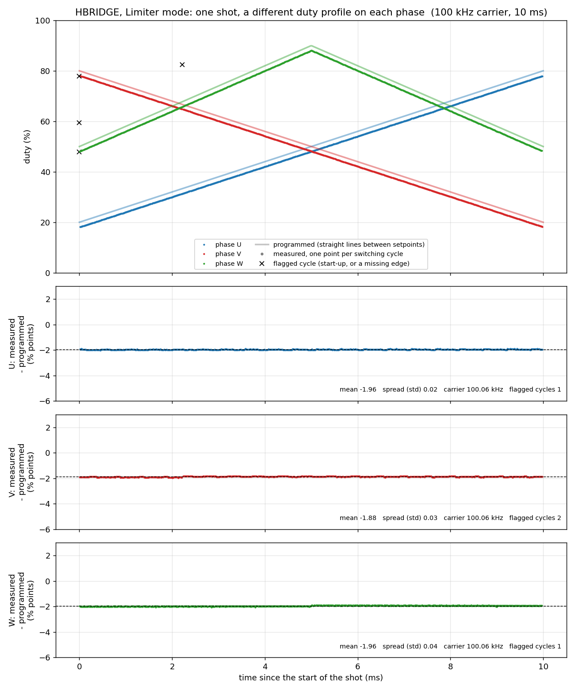

# Worked example: one Limiter shot, a different duty profile on each phase

A complete, real run for operators to read alongside `docs/operators_guide.md` (sections 5.3 and 6) and `docs/labview_hub_guide.md`. A program
connected to the host **hub**, selected **Limiter** mode, entered **one open-loop shot in which each of the three phases (U, V, W) has its own duty-cycle profile**,
armed, fired, measured what the outputs actually did, and plotted it. Every line sent to and received from the controller was kept.

- **Date and board:** 2026-10-20, the bench simulator board running the HBRIDGE firmware (`WHAM-HBRIDGE-PFMG474 v0.9`, serial not yet assigned, `SN=UNSET`).
- **Not a supply:** nothing was connected to the outputs except the bench's measurement fibers, so this shows what the *controller* did, not a power stage.
- **Open loop:** no feedback, no closed loop. Closed-loop operation is not part of this example.

## The shot

| | Setpoint 1 | Setpoint 2 | Setpoint 3 |
|---|---|---|---|
| Time | 0 | 5 ms | 10 ms |
| Carrier frequency (all phases) | 100 kHz | 100 kHz | 100 kHz |
| **Phase U duty** | 20 % | 50 % | 80 % |
| **Phase V duty** | 80 % | 50 % | 20 % |
| **Phase W duty** | 50 % | 90 % | 50 % |

U ramps up, V ramps down, W rises then falls. The controller moves frequency and duty in straight lines between setpoints. Limiter mode allows 75 – 125 kHz and 5 – 95 % per phase, and every
value above is inside that. Entered as three `SHOT:STEP <time_us> <freq_hz> <dU> <dV> <dW>` lines.



## What is in this folder

| File | Contents |
|---|---|
| `shot_plot.png` | the plot above: programmed duty (lines) against measured duty (one dot per switching cycle) for each phase, and under it the difference for each phase |
| `transcript.txt` | **every line to and from the controller through the hub**, with the local time. `>` is a command sent, `<` a reply, `<#` the hub answering a `!hub` command. Long replies (`PFMIN:RAW?`) are cut at 400 characters here; they are whole in `transcript.jsonl` |
| `transcript.jsonl` | the same transcript, one JSON record per line (`t` epoch seconds, `time`, `dir`, `line`) |
| `hub_log_excerpt.jsonl` | the **hub's own log** of the same run, copied read-only from the hub server: the same commands and replies as the hub saw them, with its identity and session fields. It is the cross-check of the client's transcript (97 commands, 97 replies, 3 marked dangerous: `PHASe:SELect`, `ARM`, `FIRE`) |
| `shot_setpoints.csv` | the shot as programmed |
| `raw_edges.json` | the raw edge capture read back from the controller for each phase (see "How the shot was measured") |
| `measured_duty.csv` | the duty, period and carrier frequency of every switching cycle of every phase, decoded from the raw edges, next to the programmed duty at that moment, with a `flag` column |
| `summary.json` | the numbers quoted below |
| `run_example.py` | the script that did all of it. It is also a worked example of how a program should talk to the hub |

## The sequence, step by step

This is the same order as the operator's guide; the transcript has every reply.

| # | What was sent | Why | Guide section |
|---|---|---|---|
| 1 | `@quiet operator-example` (the very first line, no reply) | tells the hub this is a program, so it gets only replies and unsolicited lines | hub guide 2 |
| 2 | `*IDN?`, `SYS:ID?`, `!hub status`, `!hub clients` | confirm this is an HBRIDGE controller, see who else is connected (here, one other person's terminal) | operators 5.3, 5.4 |
| 3 | `STATE?` → `OK IDLE`, `FAULT?` → `OK 0` | the controller must be idle and fault-free before anything else | operators 6.1 |
| 4 | `CONFig:MODE LIMiter`, `CONFig:MODE?`, `CONFig:LIMits?` | choose the supply and read back its limits (`OK LIMITER FREQ 75000 125000 DUTY 5 95`) | operators 6.2 |
| 5 | `PHASe:SELect UVW`, `PHASe:ENAble?` | all three phases drive (`OK U=1 V=1 W=1`) | operators 6.2 |
| 6 | `SHOT:BEGin`, three `SHOT:STEP ...`, `SHOT:END` → `OK 3 10000` | enter the shot, **one line at a time, checking each reply** | operators 6.3 |
| 7 | `SHOT?`, `SHOT:POINt? 0`, `1`, `2` | read the shot back from the controller itself: that, not what was sent, is the proof of what it holds | operators 6.3 |
| 8 | `PFMIN:EDGes 1 BOTH` (also 2, 3), `PFMIN:EDGes?`, `PFMIN:CAPTURE 1005` | measurement only: record both edges of the three outputs during the shot | (this example) |
| 9 | `ARM`, `STATE?` → `OK ARMED` | nothing electrical has happened yet | operators 6.5 |
| 10 | `FIRE` → `OK` | the shot runs | operators 6.5 |
| 11 | `STATE?` → `OK IDLE` | the shot is 10 ms long and ended by itself (idle again 0.07 s after `FIRE`) | operators 6.5, 6.6 |
| 12 | `FAULT?` → `OK 0`, `FAULT:SOURces?` → `OK PC10=0 GATEDRV=0 TABLE=0 TEST=0 OVP=0 FB=0` | no fault of any kind | operators 6.6, 9 |
| 13 | `PFMIN:STATus?`, `PFM:DIAG?` | the capture's counts (2000 edges per phase) and the shot's timing statistics | (this example) |
| 14 | `PFMIN:RAW? <input> <start> 100`, page after page | read the edge capture back; every page's numbers are added up and compared with the `SUM=` in its reply, and a damaged page is read again | (this example) |
| 15 | `PFMIN:EDGes 1 RISING` (also 2, 3) | put the capture back as it was found | (this example) |

A few things to notice in the transcript: replies come in the order the commands were sent, one reply each; the `!hub` lines are answered with `#`; the script checks `STATE?`, not the clock, to know the shot has
finished; and it stops without arming if the product or the state is not what it expects.

## How the shot was measured

The controller's phase outputs are fibred to its own capture inputs (U, V, W to PFM_Input_1, 2, 3 on this bench). With `PFMIN:EDGes <n> BOTH` an input records the time of **every** rising and falling edge,
which gives each switching cycle's period and its high time, hence its duty. The recording starts a moment before the output does, so the first cycle of each phase is a start-up cycle. This measures what the
**controller's outputs** did; it says nothing about what a power stage connected to them would do.

## What the plot shows

- **Each phase follows its own profile.** U rises, V falls, W peaks at 5 ms: three different duty profiles in one shot, as programmed.
- **A constant offset below the programmed value:** the measured duty is lower than programmed by

  | Phase | Mean (measured − programmed) | Spread (standard deviation) | Mean carrier measured |
  |---|---|---|---|
  | U | −1.96 percentage points | 0.02 | 100.06 kHz |
  | V | −1.88 | 0.03 | 100.06 kHz |
  | W | −1.96 | 0.04 | 100.06 kHz |

  The offset is **constant across the whole shot and almost the same on every phase**: about 2 points, i.e. about 200 ns of high time on a 10 µs period. It was seen in the same way earlier on the simulator (programmed 20/50/80 % read
  about 18/48/78 %) and has been put down to the dead time (100 ns) the hardware timer inserts between a phase's main output and its complement; that explanation has not been separately confirmed here. It is not noise: the spread around it is only a few hundredths of a point.
- **The carrier reads 100.06 kHz, not 100.00 kHz.** The capture's period is one timer tick (about 6 ns) shorter than the programmed period, a constant known to this measurement. It is not a frequency error.
- **Flagged cycles (black crosses).** Each phase's first cycle (start-up) is flagged, which is expected, and is excluded from the numbers above.

### One thing in this run that is not understood

Phase V has **one more flagged cycle, at about 2.2 ms (cycle 222): its period is 20.0 µs instead of 10.0 µs**. Two cycles were merged into one, so one edge is missing from phase V's record. Phases U and W show nothing like it, and the controller
reported no fault (`FAULT?` `OK 0`, all sources 0). It is **not known whether this was a missed capture or a missing output pulse**: a single run cannot tell them apart. The other 997 cycles of V are clean. It was left in the data, marked, and
left out of the statistics. If it is seen again, tell the controls team: it would need to be repeated and checked with a logic analyzer.

## Reproducing it

On a computer that can reach the hub for an idle HBRIDGE controller (here through an ssh tunnel to the hub server; see operators guide 5.2):

```bash
python3 firmware/hbridge/docs/examples/limiter_per_phase_duty_shot/run_example.py --port <hub-port> --out <a-folder>
```

`--out` defaults to this folder, so run it with another folder to keep this reference untouched. It **sends `ARM` and `FIRE`**: run it only on a controller that is yours to fire. It needs `numpy` and `matplotlib`. To redo only the decoding and the plot from
the saved raw data without touching the controller: `python3 run_example.py --reanalyse`.

Two things about this particular run, for completeness: another person's terminal was connected to the same controller at the time (visible in `!hub clients`, as the operators guide says to check before arming), and the hub log excerpt is
copied from a hub that was still keying an unprovisioned board's log directory by the last digits of its chip ID, so the excerpt was taken from a directory shared with the other controller; the `name` field (`xrexsim`) selects this controller's lines.
