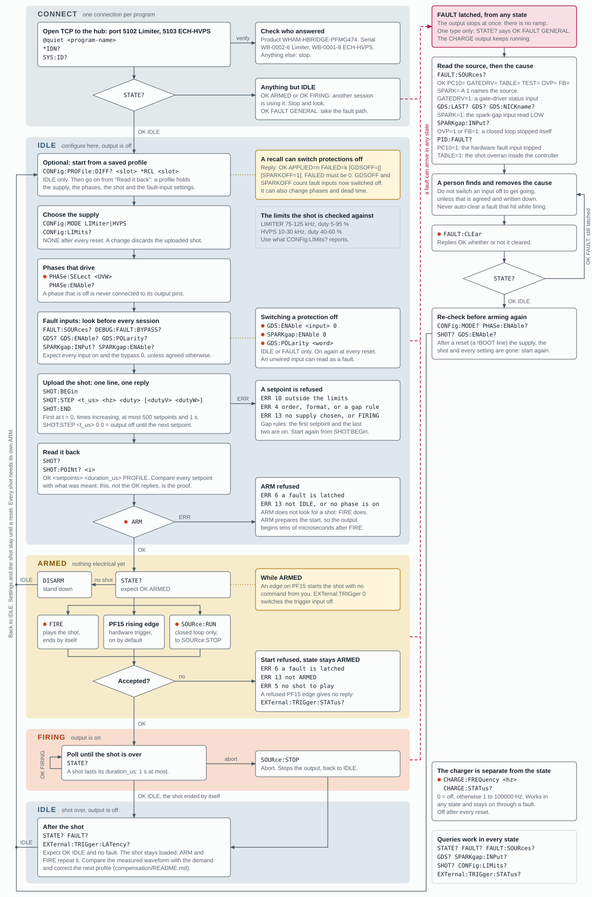

# HBRIDGE command flow

The serial commands for one shot on the Limiter or the ECH-HVPS controller (both run the HBRIDGE firmware), in the order the controller accepts them, and the path out of a fault. Check the reply to each command before sending the next.

Key: a filled orange dot marks a command the hub logs and announces as dangerous; a dashed line is the fault path; phases U, V, W are channels 1, 2, 3.

*Each band is an operating state. Work moves down the bands, a fault from any band moves right, and every finish returns through the rail on the left to IDLE.* The chart is also available as a standalone page, [hbridge_command_flow.html](hbridge_command_flow.html), to open in a browser from a checkout, or as the [SVG](hbridge_command_flow.svg) alone. The operator console carries a copy under its menu.

**The shot is a list of setpoints.** Time in whole microseconds, frequency in Hz, duty in percent; the controller moves in straight lines between setpoints, one switching period at a time. One duty applies to all three phases, three duties give each phase its own. A setpoint at 0 Hz switches the outputs off until the next setpoint, which restarts them with no ramp; the setpoint before a gap holds its value up to the gap.

**Load the shot from a file.** Typing a profile by hand is where shots go wrong. The compensation tools write the profile as a CSV (`analysis/compensation/README.md`); the operator console loads that file into its shot table, sends it and compares the read-back. A program should do the same: send from the file, then read every `SHOT:POINt?` back.

**What a recall can change.** `*RCL` puts back the supply, the shot and its tables, the phases that drive, the dead time, and the fault-input settings (which `GDS:ENAble` inputs are on, the polarity, the spark-gap enable). Show `CONFig:PROFile:DIFF? <slot>` to the operator first, and read `PHASe:ENAble?` and `GDS:ENAble?` afterwards. Nothing is recalled at boot.

**Which input is in fault.** `GDS:LAST?` replies `OK <hex> <checks>`: the levels of the twelve gate-driver inputs when the fault latched, bit 0 = input 01. Under `NORMALLY_HIGH` (the built-in polarity) the faulted inputs are the cleared bits: `FFB` is input 03. Read the polarity with `GDS:POLarity?`; do not assume it.

**A reset forgets the setup.** A `!BOOT` line can arrive at any time. The supply mode is `NONE`, the shot is gone, every fault input is on again, the dead time is 100 ns and the charger is off. Re-identify, tell the operator, and set up again or recall a saved profile.

**Not on this chart.** `DEBUG:FAULT:BYPASS 1` makes the controller ignore PC10, the gate-driver inputs and the spark-gap input. It is for a bench with nothing connected and is not a recovery step. `CONFig:DEADtime <ns>` (50 to 3000, 100 at every boot) changes the pause between the two switches of a phase: too little risks shoot-through. Closed-loop set-up (`PID:*`, `TARGet:*`) is in `docs/labview_commands.md` section 4.4.

Sources: `docs/labview_commands.md`, `docs/labview_state_and_faults.md`, `firmware/hbridge/docs/command_reference.md`, and the HBRIDGE firmware in WHAM-CONTROLLERS. On the installed ECH-HVPS, nothing is armed or fired without the operator in charge agreeing.

<!-- Generated by python/gen_command_flow.py; edit that script, not this file. -->
