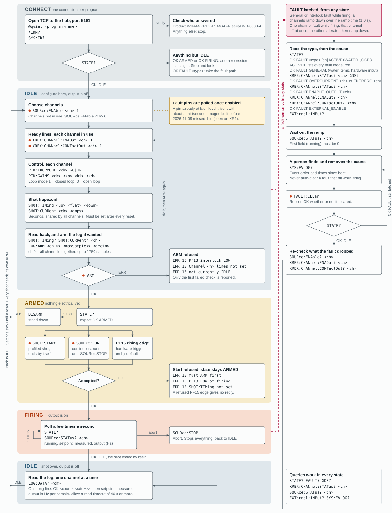

# XREX command flow

The serial commands for one Transrex shot, in the order the controller accepts them, and the path out of a fault. Check the reply to each command before sending the next.

Key: a filled orange dot marks a command the hub logs and announces as dangerous; a dashed line is the fault path; `<ch>` is the channel, 1 to 4.

*Each band is an operating state. Work moves down the bands, a fault from any band moves right, and every finish returns through the rail on the left to IDLE.* The chart is also available as a standalone page, [xrex_command_flow.html](xrex_command_flow.html), to open in a browser from a checkout, or as the [SVG](xrex_command_flow.svg) alone.

**When fault pins are read.** Water, temperature, Enerpro and overcurrent pins are all polled continuously (water, temperature and Enerpro since firmware built 2026-11-09; older images read them only on a pin change, at boot and in `FAULT:CLEar`). A disabled channel's pins are ignored. `FAULT:CLEar` in IDLE or ARMED does nothing. In FAULT, `STATE?` ends with `ACTIVE=`, the list of every fault measured.

**Commands that act outside IDLE.** `SOURce:ENAble`, `XREX:CHANnel:ENAOut` and `CONTactOut` take effect immediately in any state. While ARMED or FIRING, an enabled channel whose ready lines are not both HIGH faults, so set the lines before enabling.

**A reset forgets the setup.** A `!BOOT` line can arrive at any time. Enables, gains and shot timing are gone unless a stored profile is recalled. Re-identify, tell the operator, and do not resend the old setup silently.

**Not on this chart.** `DEBUG:FAULT:BYPASS 1` makes the controller ignore its fault detection. It is for a bench with nothing connected and is not a recovery step.

Sources: `docs/labview_commands.md`, `docs/labview_state_and_faults.md`, `firmware/xrex/docs/command_reference.md`, and the XREX firmware in WHAM-CONTROLLERS. Amps are a placeholder calibration until measured on a real Transrex.

<!-- Generated by python/gen_command_flow.py; edit that script, not this file. -->
